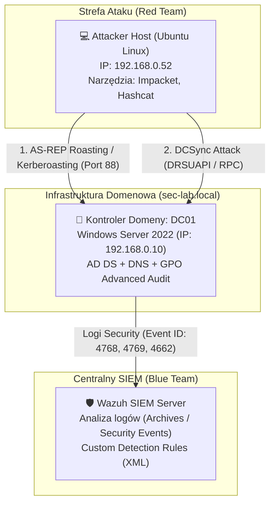

# 🏰 Active Directory Attack & Detection Engineering Lab (Purple Team)

-yellow)

## 🎯 Cel i Opis Projektu

W ponad 90% środowisk korporacyjnych zarządzanie tożsamością opiera się na usłudze **Active Directory (AD)**, a większość krytycznych incydentów bezpieczeństwa (od zaawansowanych kampanii APT po ataki ransomware) wiąże się z kompromitacją kont domenowych oraz nadużyciami w protokole **Kerberos**.

Celem tego projektu (**Purple Team Lab**) jest:
1. **Zbudowanie od zera infrastruktury domenowej** z odpowiednio skonfigurowaną zaawansowaną polityką audytu (**GPO Hardening**).
2. **Przeprowadzenie symulacji rzeczywistych ataków (Adversary Emulation)** na protokół Kerberos oraz replikację katalogową przy użyciu narzędzi ofensywnych (**Impacket**, **Hashcat**).
3. **Opracowanie precyzyjnych reguł detekcyjnych w systemie SIEM (Wazuh)** na podstawie analizy surowych logów bezpieczeństwa Windows, ze szczególnym uwzględnieniem wykrywania obniżenia poziomu szyfrowania (*Encryption Downgrade* do `RC4-HMAC`).

---

## 🛠️ Wykorzystane Technologie (Tech Stack)

| Kategoria | Technologia / Narzędzie | Zastosowanie w projekcie |
| :--- | :--- | :--- |
| **Infrastruktura & IAM** | **Windows Server 2022 (AD DS, DNS, GPO)** | Kontroler domeny `DC01` dla lasu `sec-lab.local`, zarządzanie tożsamością i zaawansowanymi politykami audytu. |
| **Telemetria & SIEM** | **Wazuh SIEM** | Zbieranie zdarzeń bezpieczeństwa kontrolera domeny (*Windows Security Log*, moduły *Archives* oraz *Security Events*). |
| **Adversary Emulation (Red Team)** | **Ubuntu Linux**, **Impacket** (`GetNPUsers.py`, `GetUserSPNs.py`, `secretsdump.py`), **Hashcat** | Przeprowadzanie ataków *AS-REP Roasting*, *Kerberoasting* oraz *DCSync*, a także łamanie hashów offline. |
| **Inżynieria Detekcji (Blue Team)** | **Wazuh Custom Rules (XML)** / **Sigma** | Wykrywanie anomalii w żądaniach biletów Kerberos (TGT/TGS) na podstawie atrybutów szyfrowania (`0x17`). |

---

## 🏗️ Architektura Laboratorium

Środowisko zostało zaprojektowane w sposób zoptymalizowany pod kątem zasobów sprzętowych, symulując pełny przepływ telemetrii oraz ruchu ofensywnego w sieci lokalnej:

---

## 🛠️ Faza 1: Budowa Infrastruktury i Przygotowanie Środowiska

### 1. Konfiguracja Maszyny Wirtualnej i Kontrolera Domeny
* Zbudowano maszynę wirtualną z systemem **Windows Server 2022 (Desktop Experience)** w środowisku VirtualBox.
* **Konfiguracja sieciowa:** Zastosowano dwie karty sieciowe:
  * **Karta 1 (Bridged):** Statyczny adres IP `192.168.0.10` zapewniający bezpośrednią komunikację z maszyną atakującą oraz serwerem SIEM.
  * **Karta 2 (NAT):** Dostęp do Internetu na potrzeby pobierania agentów oraz aktualizacji.
* Zmieniono nazwę hosta na **`DC01`**, zainstalowano rolę **Active Directory Domain Services (AD DS)** i wypromowano serwer do roli kontrolera domeny dla nowego lasu **`sec-lab.local`**.

### 2. Konfiguracja Podatnych Tożsamości (Adversary Emulation Prep)
W dedykowanej jednostce organizacyjnej (OU) o nazwie `Zespol_IT` utworzono trzy konta testowe odwzorowujące typowe błędy konfiguracyjne spotykane w audytach bezpieczeństwa:

| Konto | Konfiguracja / Podatność | Cel symulacji |
| :--- | :--- | :--- |
| **`j.kowalski`** | Włączona flaga `Do not require Kerberos preauthentication` | Podatność na atak **AS-REP Roasting** (`T1558.004`) |
| **`svc_sql`** | Przypisany identyfikator SPN: `setspn -a MSSQLSvc/DC01.sec-lab.local:1433 svc_sql` | Podatność na atak **Kerberoasting** (`T1558.003`) |
| **`adm_backup`** | Członek uprzywilejowanej grupy **Domain Admins** | Wykorzystanie nadmiarowych uprawnień do ataku **DCSync** (`T1003.006`) |

### 3. GPO Hardening i Zaawansowana Polityka Audytu
Domyślna konfiguracja systemu Windows Server nie rejestruje szczegółowych operacji biletowych protokołu Kerberos. Aby umożliwić zespołowi SOC wykrycie ataków, zmodyfikowano politykę **`Default Domain Controllers Policy`** w przystawce *Group Policy Management*, odblokowując następujące kategorie zdarzeń:
* **Audit Kerberos Authentication Service** (*Success & Failure*) – generuje **Event ID 4768** (żądania biletu TGT).
* **Audit Kerberos Service Ticket Operations** (*Success & Failure*) – generuje **Event ID 4769** (żądania biletu serwisowego TGS).
* **Audit Directory Service Access** (*Success & Failure*) – generuje **Event ID 4662** (operacje na obiektach katalogowych AD, kluczowe dla detekcji replikacji *DCSync*).

---

## 🏴‍☠️ Faza 2: Red Team – Symulacja Ataków na Active Directory

Z poziomu maszyny atakującej (Ubuntu Linux, IP: `192.168.0.52`) przeprowadzono trzy scenariusze ofensywne z wykorzystaniem pakietu **Impacket** oraz łamacza haseł **Hashcat**.

### Scenariusz 1: AS-REP Roasting (`MITRE ATT&CK T1558.004`)
* **Mechanizm ataku:** Wykorzystano brak wymogu wstępnego uwierzytelniania Kerberos dla konta `j.kowalski`. Przy użyciu skryptu `GetNPUsers.py` wysłano żądanie `AS-REQ` bezpośrednio do centrum dystrybucji kluczy (KDC), otrzymując w odpowiedzi zaszyfrowaną część wiadomości `AS-REP` bez znajomości hasła.
* **Rezultat:** Pomyślnie zrzucono hash biletu do pliku i złamano hasło w trybie offline przy użyciu narzędzia **Hashcat** (tryb `-m 18200`), odzyskując hasło w czystym tekście (`!#Abecadlo`).

### Scenariusz 2: Kerberoasting (`MITRE ATT&CK T1558.003`)
* **Mechanizm ataku:** Wykorzystując przejęte wcześniej poświadczenia domenowe, za pomocą narzędzia `GetUserSPNs.py` odpytano kontroler domeny o konta z zarejestrowanym identyfikatorem SPN i zażądano biletu serwisowego (TGS) dla konta `svc_sql`.
* **Rozwiązanie problemu środowiskowego (`KRB_AP_ERR_SKEW`):** W trakcie ataku napotkano błąd synchronizacji czasu pomiędzy maszyną atakującą a kontrolerem domeny (protokół Kerberos domyślnie odrzuca pakiety przy różnicy czasu przekraczającej 5 minut w celu ochrony przed atakami *Replay*). Problem rozwiązano poprzez ujednolicenie strefy czasowej (`UTC+01:00`) oraz wymuszenie synchronizacji czasu za pomocą PowerShella.
* **Rezultat:** Po przechwyceniu biletu TGS złamano hasło konta serwisowego `svc_sql` w narzędziu **Hashcat** (tryb `-m 13100`).

### Scenariusz 3: DCSync Attack (`MITRE ATT&CK T1003.006`)
* **Mechanizm ataku:** Wykorzystując poświadczenia uprzywilejowanego konta `adm_backup` oraz skrypt `secretsdump.py`, zasymulowano działanie kontrolera domeny i wywołano procedurę replikacji danych katalogowych za pomocą protokołu `MS-DRSR` (*Directory Replication Service Remote Protocol*).
* **Rozwiązanie problemu środowiskowego:** Napotkano błędy zależności bibliotek kryptograficznych w środowisku Pythona na stacji atakującej. Problem wyeliminowano poprzez doinstalowanie i uporządkowanie pakietu `pycryptodomex`.
* **Rezultat:** Pomyślnie zrzucono wszystkie hashe NTLM z bazy `NTDS.dit` kontrolera domeny, w tym krytyczny hash konta **`krbtgt`** (otwierający drogę do ataków typu *Golden Ticket*).

---

## 🛡️ Faza 3: Blue Team – Inżynieria Detekcji (Wazuh SIEM)

W celu wykrycia przeprowadzonych ataków skonfigurowano serwer **Wazuh SIEM** oraz przeanalizowano surowe zdarzenia bezpieczeństwa generowane przez kontroler domeny `DC01`.

### Przygotowanie Telemetrii i Środowiska Testowego
* W panelu oraz konfiguracji Wazuh uruchomiono moduły **Archives** oraz **Security Events**, co pozwoliło na głęboką inspekcję wszystkich pól XML przesyłanych z dziennika *Windows Security Log*.
* Rozwiązano konflikt środowiskowy na maszynie atakującej pomiędzy wersją deweloperską a globalną instalacją pakietu `impacket` (poprzez czystą reinstalację `pip install .`), zapewniając powtarzalne generowanie ruchu sieciowego do testowania reguł SIEM.

### Analiza Artefaktów i Zaimplementowane Reguły Detekcyjne
Podczas ataków *AS-REP Roasting* oraz *Kerberoasting* narzędzia ofensywne wymuszają użycie przestarzałego algorytmu szyfrowania **RC4-HMAC (`0x17`)** zamiast nowoczesnego standardu **AES256 (`0x12`)**, ponieważ hashe oparte na RC4 łamie się w programie Hashcat wielokrotnie szybciej. Ta anomalia stanowi główny wskaźnik kompromitacji (IoC) wykorzystany w stworzonych regułach:

#### 1. Reguła `100001` – Detekcja AS-REP Roasting (`T1558.004`)
* **Analizowane zdarzenie:** Windows Event ID **`4768`** (*A Kerberos authentication ticket (TGT) was requested*).
* **Logika detekcji:** Reguła wyzwala alarm wysokiego priorytetu w momencie, gdy w logu żądania biletu TGT parametr `preAuthType` przyjmuje wartość `0` (brak pre-autoryzacji), a jednocześnie pole `ticketEncryptionType` wskazuje na wartość `0x17` (szyfrowanie RC4-HMAC).

#### 2. Reguła `100003` – Detekcja Kerberoastingu (`T1558.003`)
* **Analizowane zdarzenie:** Windows Event ID **`4769`** (*A Kerberos service ticket was requested*).
* **Logika detekcji:** Reguła monitoruje żądania biletów serwisowych TGS i podnosi alarm w sytuacji, gdy klient celowo prosi o bilet zaszyfrowany algorytmem RC4 (`ticketEncryptionType: 0x17`), co w nowoczesnym środowisku domenowym jednoznacznie wskazuje na próbę zrzucenia biletu do łamania offline.

---

## 🔧 Napotkane Problemy i Wnioski Inżynierskie (Troubleshooting Log)

Podczas budowy laboratorium i testów rozwiązano kilka istotnych problemów technicznych:
1. **Brak telemetrii Kerberos w domyślnej instalacji Windows Server:** Zidentyfikowano, że bez jawnego włączenia podkategorii audytu w GPO (*Advanced Audit Policy Configuration*), kontroler domeny nie rejestruje zdarzeń `4768` ani `4769`.
2. **Błąd `KRB_AP_ERR_SKEW` podczas Kerberoastingu:** Zdiagnozowano odrzucanie żądań TGS przez KDC z powodu rozbieżności czasu między hostem Linux a Windows Server. Skorygowano ustawienia strefy czasowej i synchronizację zegara systemowego.
3. **Konflikty zależności Pythona (`impacket` / `pycryptodomex`):** Naprawiono błędy wykonania skryptu `secretsdump.py` oraz niespójności w globalnych pakietach Pythona na maszynie Red Team.

---

## 🚀 Kolejne Kroki (Roadmap)

Projekt jest aktywnie rozwijany. W kolejnych etapach zaplanowano:
- [ ] **Detekcja ataku DCSync:** Opracowanie reguły wykrywającej nieautoryzowaną replikację katalogową na podstawie zdarzenia **Event ID 4662** oraz identyfikatorów uprawnień replikacji (`1131f6aa-9c07-11d1-f79f-00c04fc2dcd2` – *DS-Replication-Get-Changes*).
- [ ] **Standard Sigma Rules (Detection-as-Code):** Utworzenie uniwersalnych reguł detekcyjnych w formacie YAML (katalog `sigma_rules/`) wraz z odfiltrowaniem fałszywych alarmów (*False Positives Tuning*, np. wykluczenie kont maszyn kończących się znakiem `$`).
- [ ] **Faza 4 – SOAR & Python ChatOps:**
  - Stworzenie skryptu integracyjnego w języku **Python** wysyłającego powiadomienia o incydentach w czasie rzeczywistym na kanał SOC (Discord / Slack Webhook API).
  - Wdrożenie mechanizmu *Active Response* w oparciu o **PowerShell** (`Disable-ADAccount`), automatycznie blokującego skompromitowane konto w Active Directory po wykryciu ataku.
