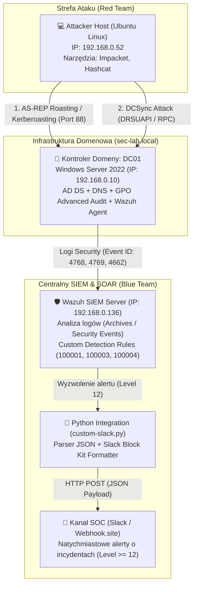

# 🏰 Active Directory Attack & Detection Engineering Lab (Purple Team & SOAR)

-brightgreen)


## 🎯 Cel i Opis Projektu

W ponad 90% środowisk korporacyjnych zarządzanie tożsamością opiera się na usłudze **Active Directory (AD)**, a większość krytycznych incydentów bezpieczeństwa (od zaawansowanych kampanii APT po ataki ransomware) wiąże się z kompromitacją kont domenowych oraz nadużyciami w protokole **Kerberos**.

Zrealizowany projekt (**Purple Team & SOAR Lab**) obejmuje cztery pełne fazy inżynieryjne:
1. **Zbudowanie od zera infrastruktury domenowej** dla lasu `sec-lab.local` z odpowiednio skonfigurowaną zaawansowaną polityką audytu (**GPO Hardening**).
2. **Przeprowadzenie symulacji rzeczywistych ataków (Adversary Emulation)** na protokół Kerberos oraz replikację katalogową (*AS-REP Roasting*, *Kerberoasting*, *DCSync*) przy użyciu narzędzi ofensywnych (**Impacket**, **Hashcat**).
3. **Opracowanie precyzyjnych reguł detekcyjnych w systemie SIEM (Wazuh)** na podstawie analizy surowych logów bezpieczeństwa Windows (`Event ID 4768`, `4769`, `4662`), wykrywających obniżenie poziomu szyfrowania (*Encryption Downgrade* do `RC4-HMAC`) oraz nieautoryzowaną replikację bazy `NTDS.dit`.
4. **Wdrożenie automatyzacji SOAR i ChatOps** poprzez autorski skrypt integracyjny w języku **Python**, który parsuje krytyczne alerty SIEM i wysyła natychmiastowe powiadomienia dla zespołu SOC w formacie *Slack Block Kit* przez REST API Webhook.

---

## 🛠️ Wykorzystane Technologie (Tech Stack)

| Kategoria | Technologia / Narzędzie | Zastosowanie w projekcie |
| :--- | :--- | :--- |
| **Infrastruktura & IAM** | **Windows Server 2022 (AD DS, DNS, GPO)** | Kontroler domeny `DC01` (`192.168.0.10`) dla lasu `sec-lab.local`, zarządzanie tożsamością i zaawansowanymi politykami audytu. |
| **Telemetria & SIEM** | **Wazuh SIEM** | Centralny menedżer (`192.168.0.136`) zbierający zdarzenia bezpieczeństwa kontrolera domeny (*Windows Security Log*, moduły *Archives* oraz *Security Events*). |
| **Adversary Emulation (Red Team)** | **Ubuntu Linux**, **Impacket** (`GetNPUsers.py`, `GetUserSPNs.py`, `secretsdump.py`), **Hashcat** | Maszyna atakująca (`192.168.0.52`) wykorzystana do przeprowadzenia ataków *AS-REP Roasting*, *Kerberoasting* oraz *DCSync*, a także łamania hashów w trybie offline. |
| **Inżynieria Detekcji (Blue Team)** | **Wazuh Custom Rules (XML)** / **Sigma** | Autorskie reguły (`100001`, `100003`, `100004`) wykrywające anomalie w biletach Kerberos (`0x17`) oraz replikację DRSUAPI (`DS-Replication-Get-Changes`). |
| **Automatyzacja (SOAR & ChatOps)** | **Python 3 (`requests`, `json`)**, **Webhook API** | Skrypt integracyjny `/var/ossec/integrations/custom-slack.py` wysyłający sformatowane powiadomienia o incydentach (poziom $\ge 12$) na kanał SOC. |

---

## 🏗️ Architektura Laboratorium

Środowisko zostało zaprojektowane w sposób zoptymalizowany pod kątem zasobów sprzętowych, symulując pełny przepływ ruchu ofensywnego, telemetrii SIEM oraz zautomatyzowanych powiadomień SOAR w sieci lokalnej:



---

## 🛠️ Faza 1: Budowa Infrastruktury i Przygotowanie Środowiska

### 1. Konfiguracja Maszyny Wirtualnej i Kontrolera Domeny
* Zbudowano maszynę wirtualną z systemem **Windows Server 2022 (Desktop Experience)** w środowisku VirtualBox.
* **Konfiguracja sieciowa:** Zastosowano dwie karty sieciowe:
  * **Karta 1 (Bridged):** Statyczny adres IP `192.168.0.10` zapewniający bezpośrednią komunikację z maszyną atakującą oraz serwerem SIEM.
  * **Karta 2 (NAT):** Dostęp do Internetu na potrzeby pobierania agentów oraz aktualizacji.
* Zmieniono nazwę hosta na **`DC01`**, zainstalowano rolę **Active Directory Domain Services (AD DS)** i wypromowano serwer do roli kontrolera domeny dla nowego lasu **`sec-lab.local`**.


### 2. Konfiguracja Podatnych Tożsamości (Adversary Emulation Prep)
W dedykowanej jednostce organizacyjnej (OU) o nazwie `Zespol_IT` utworzono trzy konta testowe odwzorowujące typowe błędy konfiguracyjne spotykane w audytach bezpieczeństwa:

| Konto | Konfiguracja / Podatność | Cel symulacji |
| :--- | :--- | :--- |
| **`j.kowalski`** | Włączona flaga `Do not require Kerberos preauthentication` | Podatność na atak **AS-REP Roasting** (`T1558.004`) |
| **`svc_sql`** | Przypisany identyfikator SPN: `setspn -a MSSQLSvc/DC01.sec-lab.local:1433 svc_sql` | Podatność na atak **Kerberoasting** (`T1558.003`) |
| **`adm_backup`** | Członek uprzywilejowanej grupy **Domain Admins** | Wykorzystanie nadmiarowych uprawnień do ataku **DCSync** (`T1003.006`) |


### 3. GPO Hardening i Zaawansowana Polityka Audytu
Domyślna konfiguracja systemu Windows Server nie rejestruje szczegółowych operacji biletowych protokołu Kerberos. Aby umożliwić zespołowi SOC wykrycie ataków, zmodyfikowano politykę **`Default Domain Controllers Policy`** w przystawce *Group Policy Management*, odblokowując następujące kategorie zdarzeń:
* **Audit Kerberos Authentication Service** (*Success & Failure*) – generuje **Event ID 4768** (żądania biletu TGT).
* **Audit Kerberos Service Ticket Operations** (*Success & Failure*) – generuje **Event ID 4769** (żądania biletu serwisowego TGS).
* **Audit Directory Service Access** (*Success & Failure*) – generuje **Event ID 4662** (operacje na obiektach katalogowych AD, kluczowe dla detekcji replikacji *DCSync*).

---

## 🏴‍☠️ Faza 2: Red Team – Symulacja Ataków na Active Directory

Z poziomu maszyny atakującej (Ubuntu Linux, IP: `192.168.0.52`) przeprowadzono trzy scenariusze ofensywne z wykorzystaniem frameworka **Impacket** oraz łamacza haseł **Hashcat**.

### Scenariusz 1: AS-REP Roasting (`MITRE ATT&CK T1558.004`)
* **Mechanizm ataku:** Wykorzystano brak wymogu wstępnego uwierzytelniania Kerberos dla konta `j.kowalski`. Przy użyciu skryptu `GetNPUsers.py` wysłano żądanie `AS-REQ` bezpośrednio do centrum dystrybucji kluczy (KDC), otrzymując w odpowiedzi zaszyfrowaną część wiadomości `AS-REP` bez znajomości hasła.
* **Rezultat:** Pomyślnie zrzucono hash biletu do pliku i złamano hasło w trybie offline przy użyciu narzędzia **Hashcat** (tryb `-m 18200`), odzyskując testowe hasło w środowisku laboratoryjnym (niepublikowane w repozytorium).


### Scenariusz 2: Kerberoasting (`MITRE ATT&CK T1558.003`)
* **Mechanizm ataku:** Wykorzystując przejęte wcześniej poświadczenia domenowe, za pomocą narzędzia `GetUserSPNs.py` odpytano kontroler domeny o konta z zarejestrowanym identyfikatorem SPN i zażądano biletu serwisowego (TGS) dla konta `svc_sql`.
* **Rozwiązanie problemu środowiskowego (`KRB_AP_ERR_SKEW`):** W trakcie ataku napotkano błąd synchronizacji czasu pomiędzy maszyną atakującą a kontrolerem domeny (protokół Kerberos domyślnie odrzuca pakiety przy różnicy czasu przekraczającej 5 minut w celu ochrony przed atakami *Replay*). Problem rozwiązano poprzez ujednolicenie strefy czasowej (`UTC+01:00`) oraz wymuszenie synchronizacji czasu za pomocą PowerShella.
* **Rezultat:** Po przechwyceniu biletu TGS złamano hasło konta serwisowego `svc_sql` w narzędziu **Hashcat** (tryb `-m 13100`).


### Scenariusz 3: DCSync Attack (`MITRE ATT&CK T1003.006`)
* **Mechanizm ataku:** Wykorzystując poświadczenia uprzywilejowanego konta `adm_backup` oraz skrypt `secretsdump.py`, zasymulowano działanie kontrolera domeny i wywołano procedurę replikacji danych katalogowych za pomocą protokołu `MS-DRSR` (*Directory Replication Service Remote Protocol*).
* **Rozwiązanie problemu środowiskowego:** Napotkano błędy zależności bibliotek kryptograficznych w środowisku Pythona na stacji atakującej. Problem wyeliminowano poprzez doinstalowanie i uporządkowanie pakietu `pycryptodomex`.
* **Rezultat:** Pomyślnie zrzucono wszystkie hashe NTLM z bazy `NTDS.dit` kontrolera domeny, w tym krytyczny hash konta **`krbtgt`** (otwierający drogę do ataków typu *Golden Ticket*).


---

## 🛡️ Faza 3: Blue Team – Inżynieria Detekcji (Wazuh SIEM)

W celu wykrycia przeprowadzonych ataków wdrożono agenta Wazuh na serwerze `DC01` i połączono go z centralnym menedżerem SIEM (`192.168.0.136`), poddając analizie surowe zdarzenia bezpieczeństwa z dziennika Windows.

### Przygotowanie Telemetrii i Środowiska Testowego
* W panelu oraz konfiguracji Wazuh uruchomiono moduły **Archives** oraz **Security Events**, co pozwoliło na głęboką inspekcję wszystkich pól XML przesyłanych z dziennika *Windows Security Log*.
* Rozwiązano konflikt środowiskowy na maszynie atakującej pomiędzy wersją deweloperską w środowisku wirtualnym `(impacket-env)` a globalną instalacją pakietu `impacket` (poprzez globalną rekompilację modułu `pip install .`), zapewniając powtarzalne generowanie ruchu sieciowego do testowania reguł SIEM.

### Analiza Artefaktów i Zaimplementowane Reguły Detekcyjne (`local_rules.xml`)
Podczas ataków *AS-REP Roasting* oraz *Kerberoasting* narzędzia ofensywne wymuszają użycie przestarzałego algorytmu szyfrowania **RC4-HMAC (`0x17`)** zamiast nowoczesnego standardu **AES256 (`0x12`)**, ponieważ hashe oparte na RC4 łamie się w programie Hashcat wielokrotnie szybciej. Z kolei atak *DCSync* pozostawia unikalny ślad w postaci żądania uprawnień replikacji DRSUAPI. Te anomalie stanowią główne wskaźniki kompromitacji (IoC) wykorzystane w trzech autorskich regułach:

#### 1. Reguła `100001` – Detekcja AS-REP Roasting (`T1558.004`)
* **Analizowane zdarzenie:** Windows Event ID **`4768`** (*A Kerberos authentication ticket (TGT) was requested*).
* **Logika detekcji:** Reguła wyzwala alarm wysokiego priorytetu w momencie, gdy w logu żądania biletu TGT parametr `preAuthType` przyjmuje wartość `^0$` (brak pre-autoryzacji), a jednocześnie pole `ticketEncryptionType` wskazuje na wartość `^0x17$` (szyfrowanie RC4-HMAC).


#### 2. Reguła `100003` – Detekcja Kerberoastingu (`T1558.003`)
* **Analizowane zdarzenie:** Windows Event ID **`4769`** (*A Kerberos service ticket was requested*).
* **Logika detekcji:** Reguła monitoruje żądania biletów serwisowych TGS i podnosi alarm w sytuacji, gdy klient celowo prosi o bilet zaszyfrowany algorytmem RC4 (`ticketEncryptionType: 0x17`), co w nowoczesnym środowisku domenowym jednoznacznie wskazuje na próbę zrzucenia biletu do łamania offline.


#### 3. Reguła `100004` – Detekcja DCSync (`T1003.006`)
* **Analizowane zdarzenie:** Windows Event ID **`4662`** (*An operation was performed on an object*).
* **Logika detekcji:** Reguła analizuje operacje na obiektach katalogowych Active Directory i wykrywa wywołania protokołu DRSUAPI zawierające specyficzny identyfikator GUID właściwości `1131f6aa-9c07-11d1-f79f-00c04fc2dcd2` (*DS-Replication-Get-Changes*), wykorzystywany podczas nieautoryzowanej replikacji hashy z bazy `NTDS.dit`.


---

## 🤖 Faza 4: Automatyzacja SOAR i ChatOps (Python & Webhook API)

Ostatnim etapem projektu było zbudowanie potoku **SOAR / ChatOps**, który automatycznie przechwytuje krytyczne alerty dotyczące kompromitacji Active Directory i w czasie rzeczywistym wysyła sformatowane powiadomienia na kanał zespołu SOC (symulowany endpoint Slack Webhook).

### 1. Konfiguracja Integracji w Menedżerze Wazuh (`/var/ossec/etc/ossec.conf`)
W głównej konfiguracji serwera Wazuh zdefiniowano blok `<integration>`, który przekazuje wszystkie alerty o poziomie krytyczności $\ge 12$ (obejmujące nasze reguły ataków na AD) w formacie JSON do dedykowanego skryptu:

```xml
<integration>
  <name>custom-slack.py</name>
  <hook_url>https://hooks.slack.com/services/REPLACE_WITH_SECRET</hook_url>
  <level>12</level>
  <alert_format>json</alert_format>
</integration>
```

### 2. Autorski Skrypt Przetwarzający (`/var/ossec/integrations/custom-slack.py`)
Napisano i wdrożono skrypt w języku **Python 3**, który odczytuje plik alertu JSON wygenerowany przez silnik Wazuh, ekstrahuje kluczowe metadane incydentu (opis reguły, poziom krytyczności, identyfikator techniki MITRE ATT&CK), formatuje wiadomość zgodnie ze standardem **Slack Block Kit** i wysyła ją żądaniem HTTP POST. Dodatkowo zaimplementowano lokalny logger diagnostyczny (`/tmp/slack_debug.log`), który umożliwił precyzyjne debugowanie wywołań systemowych demona `wazuh-integratord`:

```python
#!/usr/bin/env python3
import sys
import json
import requests
import traceback

LOG_FILE = "/tmp/slack_debug.log"

def log_debug(msg):
    with open(LOG_FILE, "a") as f:
        f.write(msg + "\n")

def send_alert(alert_file, hook_url):
    try:
        log_debug(f"Odczytywanie alertu: {alert_file}")
        with open(alert_file, 'r') as f:
            alert = json.load(f)

        # 1. Podstawowe metadane reguły
        rule_desc = alert.get('rule', {}).get('description', 'Brak opisu')
        level = alert.get('rule', {}).get('level', '0')
        mitre_id = alert.get('rule', {}).get('mitre', {}).get('id', ['N/A'])[0]
        
        # 2. Głęboki kontekst z logów Windows (Event Data)
        win_data = alert.get('data', {}).get('win', {})
        event_id = win_data.get('system', {}).get('eventID', 'N/A')
        
        event_data = win_data.get('eventdata', {})
        source_ip = event_data.get('ipAddress', 'N/A')
        subject_user = event_data.get('subjectUserName', 'N/A')
        
        # Cel różni się w zależności od typu logu (np. 4769 to serviceName, 4662 to objectName/targetUserName)
        target = event_data.get('targetUserName') or event_data.get('serviceName') or event_data.get('objectName', 'N/A')

        # 3. Formatowanie ładunku w standardzie Slack Block Kit
        slack_msg = {
            "blocks": [
                {
                    "type": "header",
                    "text": {
                        "type": "plain_text",
                        "text": "🚨 Wazuh SOC Alert",
                        "emoji": True
                    }
                },
                {
                    "type": "section",
                    "text": {
                        "type": "mrkdwn",
                        "text": f"*Reguła:* {rule_desc}\n*Poziom:* {level}\n*MITRE ATT&CK:* {mitre_id}"
                    }
                },
                {
                    "type": "divider"
                },
                {
                    "type": "section",
                    "fields": [
                        {
                            "type": "mrkdwn",
                            "text": f"*Event ID:*\n{event_id}"
                        },
                        {
                            "type": "mrkdwn",
                            "text": f"*Source IP:*\n{source_ip}"
                        },
                        {
                            "type": "mrkdwn",
                            "text": f"*Attacker (Subject):*\n{subject_user}"
                        },
                        {
                            "type": "mrkdwn",
                            "text": f"*Target/Service:*\n{target}"
                        }
                    ]
                }
            ]
        }

        log_debug("Wysylanie alertu do skonfigurowanego webhooka")
        response = requests.post(hook_url, json=slack_msg, timeout=5)
        response.raise_for_status()
        log_debug(f"Status HTTP: {response.status_code}")
        
    except (OSError, ValueError, json.JSONDecodeError, requests.RequestException) as e:
        log_debug(f"CRITICAL ERROR: {str(e)}")
        log_debug(traceback.format_exc())
        sys.exit(1)

if __name__ == "__main__":
    if len(sys.argv) < 4:
        log_debug("Za malo argumentow: oczekiwano alert_file, api_key i hook_url")
        sys.exit(2)
    send_alert(sys.argv[1], sys.argv[3])
```

Skrypt parsuje również głęboki kontekst z węzła `data.win.eventdata`, przekazując do Slacka identyfikator zdarzenia, źródłowy adres IP, użytkownika będącego podmiotem żądania oraz cel lub nazwę usługi.

Po zrestartowaniu usługi `wazuh-manager` i ponownym przeprowadzeniu ataku *DCSync*, ładunek JSON z pełnymi informacjami o incydencie dotarł bezbłędnie na zdefiniowany endpoint Webhook (`HTTP 200 OK`).


Zrzut potwierdzający pomyślne dostarczenie ładunku alertu do webhooka (`HTTP 200 OK`).

---

## 🧪 Faza 5: Detection-as-Code (Sigma) i CI/CD

Reguły detekcyjne `100001`, `100003` oraz `100004` zostały przeniesione do uniwersalnego formatu YAML zgodnego z Sigma. Pliki znajdują się w katalogu `Rules/Sigma/` i zawierają dodatkowe strojenie fałszywych alarmów, między innymi wykluczenia kont maszynowych kończących się znakiem `$`.

Repozytorium korzysta z GitHub Actions, które przy zmianach reguł Sigma automatycznie instaluje `sigma-cli` i waliduje składnię wszystkich plików. Dzięki temu błędne reguły mogą zostać wykryte przed scaleniem zmian.


---

## 🔧 Napotkane Problemy i Wnioski Inżynierskie (Troubleshooting Log)

Podczas budowy laboratorium, symulacji ataków oraz wdrażania potoku SOAR zdiagnozowano i rozwiązano szereg istotnych problemów technicznych:

1. **Brak telemetrii Kerberos w domyślnej instalacji Windows Server:** Zidentyfikowano, że bez jawnego włączenia podkategorii audytu w GPO (*Advanced Audit Policy Configuration*), kontroler domeny nie rejestruje zdarzeń `4768`, `4769` ani szczegółowych operacji katalogowych `4662`.
2. **Błąd `KRB_AP_ERR_SKEW` podczas Kerberoastingu:** Zdiagnozowano odrzucanie żądań TGS przez KDC z powodu rozbieżności czasu między hostem Linux a Windows Server. Skorygowano ustawienia strefy czasowej (`UTC+01:00`) i wymuszono synchronizację zegara systemowego w PowerShellu.
3. **Konflikty zależności Pythona (`impacket` / `pycryptodomex`):** Naprawiono błędy wykonania skryptu `secretsdump.py` oraz niespójności pomiędzy środowiskiem wirtualnym `(impacket-env)` a globalnymi pakietami Pythona na maszynie Red Team poprzez rekompilację modułu (`pip install .`).
4. **Uprawnienia systemowe integracji Wazuh (`root:wazuh` vs `ossec`):** Domyślna dokumentacja wskazująca na historyczną grupę systemową `ossec` powodowała błąd uprawnień na serwerze Ubuntu. Problem rozwiązano po weryfikacji obecnej architektury uprawnień demona i zastosowaniu komendy `sudo chown root:wazuh custom-slack.py` oraz nadaniu praw wykonywania (`chmod 750`).
5. **Brakujące zależności HTTP poza środowiskiem wirtualnym:** Demon `wazuh-integratord` uruchamia skrypty przy użyciu systemowego interpretera Pythona, co powodowało ciche błędy importu biblioteki `requests`. Problem wyeliminowano, instalując pakiet natywnie w systemie operacyjnym (`sudo apt install python3-requests`).
6. **Parsowanie argumentów integracji Wazuh:** Skrypt korzysta ze standardowego kontraktu `alert_file`, `api_key`, `hook_url` (`sys.argv[1]` i `sys.argv[3]`) oraz nie zapisuje adresu webhooka do logu. Błędy odczytu alertu, JSON i HTTP kończą działanie kodem różnym od zera, dzięki czemu Wazuh może je zasygnalizować.

---

## 🧭 Możliwości Dalszego Rozwoju (Future Enhancements)

* **Active Response na Kontrolerze Domeny:** Rozbudowa warstwy SOAR o skrypt PowerShell uruchamiany bezpośrednio przez agenta Wazuh na serwerze `DC01`, automatycznie blokujący skompromitowane konto domenowe (`Disable-ADAccount`) natychmiast po wykryciu ataku.
