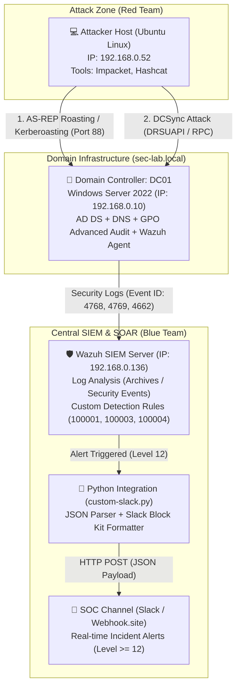

# 🏰 Active Directory Attack & Detection Engineering Lab (Purple Team & SOAR)

-brightgreen)


## 🎯 Project Overview & Objectives

In over 90% of enterprise environments, identity and access management relies on **Active Directory (AD)**, and the vast majority of critical security incidents (ranging from advanced APT campaigns to ransomware outbreaks) involve domain account compromise and **Kerberos** protocol abuse.

This completed **Purple Team & SOAR Lab** encompasses four core engineering phases:
1. **Building an Active Directory infrastructure from scratch** for the `sec-lab.local` forest with properly hardened advanced audit policies (**GPO Hardening**).
2. **Conducting real-world Adversary Emulation** targeting the Kerberos protocol and directory replication (*AS-REP Roasting*, *Kerberoasting*, *DCSync*) using offensive security tooling (**Impacket**, **Hashcat**).
3. **Engineering high-fidelity detection rules in Wazuh SIEM** based on deep analysis of raw Windows Security logs (`Event ID 4768`, `4769`, `4662`), specifically targeting Kerberos encryption downgrades (`RC4-HMAC` / `0x17`) and unauthorized `NTDS.dit` replication.
4. **Implementing SOAR & ChatOps automation** via a custom **Python** integration script that parses critical SIEM alerts and dispatches real-time incident notifications formatted in *Slack Block Kit* over a REST API Webhook.

---

## 🛠️ Tech Stack & Tooling

| Category | Technology / Tool | Role in the Project |
| :--- | :--- | :--- |
| **Infrastructure & IAM** | **Windows Server 2022 (AD DS, DNS, GPO)** | Domain Controller `DC01` (`192.168.0.10`) for the `sec-lab.local` forest, managing identities and Advanced Audit Policy GPOs. |
| **Telemetry & SIEM** | **Wazuh SIEM** | Central Manager (`192.168.0.136`) ingesting Domain Controller security telemetry (*Windows Security Log*, *Archives*, and *Security Events* modules). |
| **Adversary Emulation (Red Team)** | **Ubuntu Linux**, **Impacket** (`GetNPUsers.py`, `GetUserSPNs.py`, `secretsdump.py`), **Hashcat** | Attacking host (`192.168.0.52`) used to execute *AS-REP Roasting*, *Kerberoasting*, and *DCSync* attacks, followed by offline password cracking. |
| **Detection Engineering (Blue Team)** | **Wazuh Custom Rules (XML)** / **Sigma** | Custom detection rules (`100001`, `100003`, `100004`) identifying Kerberos ticket anomalies (`0x17`) and DRSUAPI replication (`DS-Replication-Get-Changes`). |
| **Automation (SOAR & ChatOps)** | **Python 3 (`requests`, `json`)**, **Webhook API** | Custom integration script `/var/ossec/integrations/custom-slack.py` delivering formatted high-severity incident alerts (Level $\ge 12$) to the SOC channel. |

---

## 🏗️ Lab Architecture

The lab environment was engineered for optimal hardware utilization while simulating a complete enterprise data flow—from offensive network traffic and SIEM telemetry ingestion to automated SOAR webhook notifications:



---

## 🛠️ Phase 1: Infrastructure Deployment & Environment Preparation

### 1. Virtual Machine & Domain Controller Setup
* Deployed a **Windows Server 2022 (Desktop Experience)** virtual machine in VirtualBox.
* **Network Configuration:** Configured dual network adapters:
  * **Adapter 1 (Bridged):** Assigned a static IP address (`192.168.0.10`) to enable direct communication with the attacking Linux host and the Wazuh SIEM server.
  * **Adapter 2 (NAT):** Provided Internet connectivity for agent installation and system updates.
* Renamed the host to **`DC01`**, installed the **Active Directory Domain Services (AD DS)** role, and promoted the server to a Domain Controller for the newly created **`sec-lab.local`** forest.


### 2. Configuring Vulnerable Identities (Adversary Emulation Prep)
Within a dedicated Organizational Unit (OU) named `Zespol_IT`, three test accounts were provisioned to replicate real-world Active Directory misconfigurations frequently uncovered during security assessments:

| Account | Configuration / Misconfiguration | Simulation Objective |
| :--- | :--- | :--- |
| **`j.kowalski`** | Enabled flag: `Do not require Kerberos preauthentication` | Vulnerable to **AS-REP Roasting** (`T1558.004`) |
| **`svc_sql`** | Assigned Service Principal Name (SPN): `setspn -a MSSQLSvc/DC01.sec-lab.local:1433 svc_sql` | Vulnerable to **Kerberoasting** (`T1558.003`) |
| **`adm_backup`** | Member of the privileged **Domain Admins** group | Excessive privileges abused for **DCSync** (`T1003.006`) |


### 3. GPO Hardening & Advanced Audit Policy Configuration
By default, Windows Server does not log granular Kerberos ticket operations or directory object access. To provide the SOC with the necessary visibility, the **`Default Domain Controllers Policy`** was modified via *Group Policy Management* to enable the following audit subcategories:
* **Audit Kerberos Authentication Service** (*Success & Failure*) – generates **Event ID 4768** (TGT requests).
* **Audit Kerberos Service Ticket Operations** (*Success & Failure*) – generates **Event ID 4769** (TGS service ticket requests).
* **Audit Directory Service Access** (*Success & Failure*) – generates **Event ID 4662** (operations performed on AD objects, essential for detecting *DCSync* replication).

---

## 🏴‍☠️ Phase 2: Red Team – Active Directory Adversary Emulation

From the attacking machine (Ubuntu Linux, IP: `192.168.0.52`), three offensive scenarios were executed using the **Impacket** framework and **Hashcat**.

### Scenario 1: AS-REP Roasting (`MITRE ATT&CK T1558.004`)
* **Attack Mechanics:** Leveraged the disabled Kerberos pre-authentication requirement on the `j.kowalski` account. Using `GetNPUsers.py`, an `AS-REQ` request was sent directly to the Key Distribution Center (KDC), which returned an `AS-REP` message containing material encrypted with the user's NTLM hash—without requiring prior authentication.
* **Result:** Successfully dumped the ticket hash to a file and cracked it offline using **Hashcat** (mode `-m 18200`), recovering a test password in the lab environment (not published in this repository).


### Scenario 2: Kerberoasting (`MITRE ATT&CK T1558.003`)
* **Attack Mechanics:** Using the compromised domain credentials, `GetUserSPNs.py` was used to query the Domain Controller for accounts with registered SPNs and request a Service Ticket (TGS) for the `svc_sql` service account.
* **Engineering Troubleshooting (`KRB_AP_ERR_SKEW`):** During initial execution, the KDC rejected ticket requests due to a clock synchronization discrepancy between the Linux attacker host and the Windows Domain Controller (Kerberos enforces a default 5-minute maximum clock skew to prevent replay attacks). The issue was resolved by aligning time zones (`UTC+01:00`) and forcing time synchronization via PowerShell.
* **Result:** Captured the TGS ticket and cracked the `svc_sql` service account password offline using **Hashcat** (mode `-m 13100`).


### Scenario 3: DCSync Attack (`MITRE ATT&CK T1003.006`)
* **Attack Mechanics:** Utilizing the privileged `adm_backup` account and Impacket's `secretsdump.py`, the attacking host impersonated a Domain Controller and initiated directory replication via the `MS-DRSR` (*Directory Replication Service Remote Protocol*) interface.
* **Engineering Troubleshooting:** Resolved Python cryptographic library dependency conflicts on the attacking workstation by properly installing and linking the `pycryptodomex` package.
* **Result:** Successfully extracted all NTLM password hashes from the Domain Controller's `NTDS.dit` database, including the critical **`krbtgt`** account hash (which enables complete domain persistence via *Golden Ticket* attacks).


---

## 🛡️ Phase 3: Blue Team – Detection Engineering (Wazuh SIEM)

To detect the simulated attacks, the Wazuh agent was deployed on `DC01` and connected to the central Wazuh Manager (`192.168.0.136`), enabling real-time analysis of raw Windows Security events.

### Telemetry Preparation & Test Environment Alignment
* Enabled the **Archives** and **Security Events** modules in Wazuh, allowing full inspection of raw XML fields generated by the *Windows Security Log*.
* Resolved a package conflict on the attacking machine between a virtual environment `(impacket-env)` development build and the global `impacket` installation (by recompiling globally via `pip install .`), ensuring consistent offensive traffic generation during rule validation.

### Artifact Analysis & Custom Detection Rules (`local_rules.xml`)
During *AS-REP Roasting* and *Kerberoasting*, offensive tools intentionally request the legacy **RC4-HMAC (`0x17`)** encryption algorithm instead of modern **AES256 (`0x12`)** because RC4-encrypted tickets can be cracked exponentially faster offline. Meanwhile, a *DCSync* attack leaves a distinct footprint by requesting specific DRSUAPI replication privileges. These high-signal Indicators of Compromise (IoCs) were codified into three custom Wazuh rules:

#### 1. Rule `100001` – AS-REP Roasting Detection (`T1558.004`)
* **Monitored Event:** Windows Event ID **`4768`** (*A Kerberos authentication ticket (TGT) was requested*).
* **Detection Logic:** Triggers a high-severity alert when a TGT request contains `preAuthType` equal to `^0$` (no pre-authentication) combined with a downgraded `ticketEncryptionType` of `^0x17$` (RC4-HMAC).


#### 2. Rule `100003` – Kerberoasting Detection (`T1558.003`)
* **Monitored Event:** Windows Event ID **`4769`** (*A Kerberos service ticket was requested*).
* **Detection Logic:** Monitors TGS service ticket requests and raises an alert whenever a client explicitly requests RC4 encryption (`ticketEncryptionType: ^0x17$`), which in modern Active Directory environments strongly indicates an attempt to dump service tickets for offline cracking.


#### 3. Rule `100004` – DCSync Attack Detection (`T1003.006`)
* **Monitored Event:** Windows Event ID **`4662`** (*An operation was performed on an object*).
* **Detection Logic:** Inspects directory service access logs for operations referencing the specific extended right GUID `1131f6aa-9c07-11d1-f79f-00c04fc2dcd2` (*DS-Replication-Get-Changes*), immediately flagging unauthorized directory replication attempts.


---

## 🤖 Phase 4: SOAR Automation & ChatOps (Python & Webhook API)

The final phase of the project involved building an automated **SOAR / ChatOps pipeline** capable of intercepting high-severity Active Directory alerts and dispatching real-time notifications to a SOC communication channel (simulated via a Slack Webhook endpoint).

### 1. Wazuh Manager Integration Configuration (`/var/ossec/etc/ossec.conf`)
Added a dedicated `<integration>` block to the Wazuh Manager configuration, instructing `wazuh-integratord` to forward all alerts with a severity level $\ge 12$ (matching our custom AD detection rules) in JSON format to the custom script:

```xml
<integration>
  <name>custom-slack.py</name>
  <hook_url>https://hooks.slack.com/services/REPLACE_WITH_SECRET</hook_url>
  <level>12</level>
  <alert_format>json</alert_format>
</integration>
```

### 2. Custom SOAR Processing Script (`/var/ossec/integrations/custom-slack.py`)
Developed and deployed a **Python 3** script that parses the JSON alert file generated by Wazuh, extracts key incident context (rule description, severity level, MITRE ATT&CK technique ID), formats the payload using **Slack Block Kit**, and dispatches it via an HTTP POST request. The script also parses deep context from `data.win.eventdata`, forwarding the event ID, source IP, subject user, and target or service name directly to Slack. A custom diagnostic logger (`/tmp/slack_debug.log`) was also built into the script to trace execution arguments passed by the Wazuh daemon:

```python
#!/usr/bin/env python3
import sys
import json
import requests
import traceback

LOG_FILE = "/tmp/slack_debug.log"

def log_debug(msg):
    with open(LOG_FILE, "a") as f:
        f.write(msg + "\n")

def send_alert(alert_file, hook_url):
    try:
        log_debug(f"Odczytywanie alertu: {alert_file}")
        with open(alert_file, 'r') as f:
            alert = json.load(f)

        # 1. Podstawowe metadane reguły
        rule_desc = alert.get('rule', {}).get('description', 'Brak opisu')
        level = alert.get('rule', {}).get('level', '0')
        mitre_id = alert.get('rule', {}).get('mitre', {}).get('id', ['N/A'])[0]
        
        # 2. Głęboki kontekst z logów Windows (Event Data)
        win_data = alert.get('data', {}).get('win', {})
        event_id = win_data.get('system', {}).get('eventID', 'N/A')
        
        event_data = win_data.get('eventdata', {})
        source_ip = event_data.get('ipAddress', 'N/A')
        subject_user = event_data.get('subjectUserName', 'N/A')
        
        # Cel różni się w zależności od typu logu (np. 4769 to serviceName, 4662 to objectName/targetUserName)
        target = event_data.get('targetUserName') or event_data.get('serviceName') or event_data.get('objectName', 'N/A')

        # 3. Formatowanie ładunku w standardzie Slack Block Kit
        slack_msg = {
            "blocks": [
                {
                    "type": "header",
                    "text": {
                        "type": "plain_text",
                        "text": "🚨 Wazuh SOC Alert",
                        "emoji": True
                    }
                },
                {
                    "type": "section",
                    "text": {
                        "type": "mrkdwn",
                        "text": f"*Reguła:* {rule_desc}\n*Poziom:* {level}\n*MITRE ATT&CK:* {mitre_id}"
                    }
                },
                {
                    "type": "divider"
                },
                {
                    "type": "section",
                    "fields": [
                        {
                            "type": "mrkdwn",
                            "text": f"*Event ID:*\n{event_id}"
                        },
                        {
                            "type": "mrkdwn",
                            "text": f"*Source IP:*\n{source_ip}"
                        },
                        {
                            "type": "mrkdwn",
                            "text": f"*Attacker (Subject):*\n{subject_user}"
                        },
                        {
                            "type": "mrkdwn",
                            "text": f"*Target/Service:*\n{target}"
                        }
                    ]
                }
            ]
        }

        log_debug("Wysylanie alertu do skonfigurowanego webhooka")
        response = requests.post(hook_url, json=slack_msg, timeout=5)
        response.raise_for_status()
        log_debug(f"Status HTTP: {response.status_code}")
        
    except (OSError, ValueError, json.JSONDecodeError, requests.RequestException) as e:
        log_debug(f"CRITICAL ERROR: {str(e)}")
        log_debug(traceback.format_exc())
        sys.exit(1)

if __name__ == "__main__":
    if len(sys.argv) < 4:
        log_debug("Za malo argumentow: oczekiwano alert_file, api_key i hook_url")
        sys.exit(2)
    send_alert(sys.argv[1], sys.argv[3])
```


After restarting the `wazuh-manager` service and re-running the *DCSync* attack, the formatted JSON incident payload was immediately delivered to the webhook endpoint (`HTTP 200 OK`).


Screenshot confirming successful delivery of the alert payload to the webhook (`HTTP 200 OK`).


---

## 🧪 Phase 5: Detection-as-Code (Sigma) and CI/CD

Detection rules `100001`, `100003`, and `100004` have been translated into the vendor-agnostic Sigma YAML format. The rules are stored in `Rules/Sigma/` and include false-positive tuning, including exclusions for machine accounts ending with `$`.

The repository uses GitHub Actions to install `sigma-cli` and validate all Sigma rule files automatically whenever the Sigma rules change. This catches invalid rules before changes are merged.


---

## 🔧 Engineering Troubleshooting & Lessons Learned

Throughout the deployment, offensive simulation, and SOAR integration phases, several real-world engineering challenges were diagnosed and resolved:

1. **Missing Default Kerberos Telemetry in Windows Server:** Identified that out-of-the-box Windows Server installations do not log Kerberos ticket events (`4768`, `4769`) or granular directory object access (`4662`) unless explicitly enabled under *Advanced Audit Policy Configuration* in GPO.
2. **Kerberos Clock Skew Error (`KRB_AP_ERR_SKEW`):** Diagnosed KDC ticket rejections during Kerberoasting caused by time drift between the Ubuntu host and the Windows Domain Controller. Aligned time zones (`UTC+01:00`) and forced system clock synchronization via PowerShell.
3. **Python Environment & Cryptographic Dependency Conflicts:** Resolved `secretsdump.py` execution failures and path conflicts between the `(impacket-env)` virtual environment and global packages by installing `pycryptodomex` and recompiling Impacket globally (`pip install .`).
4. **Wazuh Integration File Ownership (`root:wazuh` vs `ossec`):** Legacy documentation referencing the deprecated `ossec` group caused permission errors on Ubuntu Server. Updated file ownership to match modern Wazuh daemon architecture (`sudo chown root:wazuh custom-slack.py` and `chmod 750`).
5. **System-level Python Dependencies Outside Virtual Environments:** Because `wazuh-integratord` invokes integration scripts using the system default Python interpreter, the script initially failed silently due to a missing `requests` module. Fixed by installing the package globally via apt (`sudo apt install python3-requests`).
6. **Wazuh integration argument parsing:** The script follows the standard `alert_file`, `api_key`, `hook_url` contract (`sys.argv[1]` and `sys.argv[3]`) and does not write the webhook URL to the debug log. Alert-file, JSON, and HTTP failures exit with a non-zero status so Wazuh can report them.

---

## 🧭 Future Enhancements

* **Automated Active Directory Remediation (Active Response):** Extending the SOAR pipeline with a PowerShell script executed directly on `DC01` by the Wazuh agent to automatically disable compromised domain accounts (`Disable-ADAccount`) upon high-confidence alert triggers.
